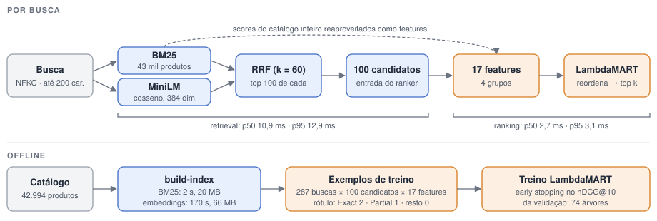

# Nota técnica: busca e ranking de produtos no WANDS

**Resultado no teste (96 buscas):** retrieval híbrido + LambdaMART chega a **nDCG@10 de 0,764**, contra 0,694 do BM25 e 0,728 do híbrido sem ranker. O LTR soma +0,036 (IC 95% [+0,009; +0,064]). Latência p95: 12,9 ms no retrieval e 3,1 ms no ranking, em CPU.

## 1. Arquitetura

- **Retrieval:** BM25 próprio (k1 1,2, b 0,75) sobre nome, classe, categoria e descrição, e `all-MiniLM-L6-v2` (384 dimensões, commit fixo) sobre nome, classe e categoria, com embeddings normalizados e busca exata. O RRF (k = 60) junta o top 100 de cada lista usando só a posição, sem calibrar escalas.
- **Ranking:** um LambdaMART (LightGBM) reordena os 100 candidatos. O BM25 e o cosseno do catálogo inteiro, já calculados no retrieval, entram como features.
- **Por que duas etapas:** o ranker pode usar features mais caras em 100 produtos, e não em 43 mil. O custo é que ele não recupera o que o retrieval perdeu.
- **Interface:** `uv run search`. Entrada inválida dá erro claro; texto longo é cortado em 200 caracteres.

## 2. Preparação dos dados

- 231.859 pares julgados em 480 buscas (11% Exact, 63% Partial, 26% Irrelevant). Pares repetidos viram um só; saem os 14 conflitantes e a única busca sem Exact nem Partial.
- Produto não julgado conta como irrelevante. É a escolha conservadora, e o viés que ela cria é discutido na seção 8.
- **Split por query**, 60/20/20 (287/96/96), estratificado pela fração de Exact, com seed 42 (`reports/data/splits.csv`).

## 3. Protocolo de avaliação

- **Métricas:** Recall@100 só com os Exact (retrieval); nDCG@10 com ganhos 2/1/0 e ideal sobre todos os julgados da busca (ranking); MRR@10, nDCG condensado (ignora os não julgados) e judged@10 como auxiliares.
- **Comparação:** bootstrap pareado por busca, com IC 95%. Uma variante só substitui a base se o IC da diferença ficar todo acima de zero.
- **Seleção só na validação** (retriever por Recall@100, ranker por nDCG@10); estudos extras com CV em 5 partes sobre treino + validação (383 buscas). **Teste avaliado uma vez**: o comando recusa rodar de novo sem `--force`.

## 4. Resultados por split

| | Treino | Validação | Teste |
|---|---|---|---|
| Recall@100, híbrido | 0,671 | 0,677 | 0,605 |
| nDCG@10, ordem do híbrido | 0,775 | 0,758 | 0,728 |
| nDCG@10, híbrido + LTR | 0,873 | 0,786 | 0,764 |
| nDCG condensado, híbrido + LTR | 0,895 | 0,832 | 0,813 |

- A diferença entre treino e validação mostra quanto o ranker decora. A validação também escolheu o ponto de parada e sai levemente otimista; o teste é a estimativa honesta.
- **Retrieval:** na validação, o denso recupera menos que o BM25 (0,589 contra 0,669), mas ordena melhor o topo; o híbrido fica com o recall do BM25 e a melhor ordem. No teste, o recall empata com o BM25 (−0,004, IC [−0,031; +0,021]) e a ordem melhora (0,694 → 0,728).

## 5. Ranker

**Features.** São 17, calculadas para cada par (busca, candidato):

| Grupo | Features |
|---|---|
| retrieval | `bm25`, `cosine` e a posição do produto no BM25, no denso e no RRF |
| text | fração das palavras da busca no nome, na classe e na categoria; busca inteira contida no nome; nº de palavras |
| attributes | fração das palavras nos valores de atributo; números da busca no nome ou nos atributos (vazia se a busca não tem número) |
| numeric | log das avaliações e dos reviews, nota média (vazia sem avaliação), nº de atributos, log do tamanho da descrição |

**Exemplos e treino.** Cada busca do treino gera seus 100 candidatos pelo híbrido, os mesmos da busca real. Cada par vira uma linha com as 17 features e o rótulo (Exact 2, Partial 1, Irrelevant e não julgado 0), e cada busca é um grupo. LightGBM `lambdarank`: learning rate 0,05, 31 folhas, mínimo de 20 por folha, subsample e colsample 0,8, ganhos 0/1/3 no treino, early stopping de 50 rodadas no nDCG@10 da validação (parou em 74 árvores).

**Contra o baseline** (a ordem do híbrido): 0,758 → 0,786 na validação e 0,728 → 0,764 no teste. No nDCG condensado do teste, −0,002, IC [−0,018; +0,014] (seção 8).

**Ablação (validação).** Retreinei o modelo sem cada grupo:

| Sem o grupo | nDCG@10 | Diferença, IC 95% |
|---|---|---|
| — (modelo completo) | 0,786 | — |
| retrieval | 0,765 | −0,021 [−0,051; +0,009] |
| text | 0,768 | **−0,018 [−0,035; −0,003]** |
| attributes | 0,778 | −0,008 [−0,019; +0,002] |
| numeric | 0,778 | −0,008 [−0,019; +0,004] |

Tirar qualquer grupo piora, mas, com 96 buscas, só a queda do texto é significativa. Os grupos se sobrepõem (`bm25` e `name_overlap`), então a ablação mede o que cada um agrega além dos outros. Maior ganho no modelo: `retrieval_rank`, `name_overlap` e `bm25`.

## 6. Custo e latência

- **Por busca** (CPU, 96 buscas do teste, cache limpo), p50 / p95: retrieval 10,9 / 12,9 ms; ranking 2,7 / 3,1 ms.
- **Indexação** (42.994 produtos): BM25 em 2 s (20 MB); embeddings em 170 s, 4 ms por produto (66 MB). Tudo cabe em memória; com milhões de produtos, a busca exata daria lugar a um índice ANN.

## 7. Tentativas não adotadas

Contra a v1, em nDCG@10: treino só com os julgados (−0,056); features v2 (+0,006, IC passando pelo zero, ranking 1,6× mais lento); correções da v1 (nenhuma melhora; o IDF piora −0,009); peso maior do Exact (−0,009); outros objetivos (−0,002 a −0,034); `bge-small` com texto longo no lugar do MiniLM (+0,007, IC passando pelo zero; indexação ~10× mais lenta). Todas na validação ou com CV, sem tocar no teste; detalhes em `EXPERIMENTOS.md`.

## 8. Análise de erros (validação)

Gráficos e tabelas em `analysis/08_error_analysis.ipynb`.

- **A perda está em ordenar.** A melhor ordem possível dos 100 candidatos daria 0,944. Da distância até 1, 74% é do ranking e 26% do retrieval.
- **O LTR ajuda poucas buscas muito.** Ele melhora 36 buscas, empata em 46 e piora 14. Os ganhos chegam a +0,56; as perdas, no máximo, a −0,17.
- **Palavras fora do catálogo são o ponto mais fraco:** erros de digitação, palavras coladas e nomes dão 0,553, contra 0,802 nas demais (só 6 buscas). Buscas genéricas ("living room designs") também estão entre as piores.
- **O recall não satura em 100.** É 0,677 com 100 candidatos e seria 0,783 com 200.
- **O ganho do LTR provavelmente é real, apesar do pooling.** Ele reduz os não julgados no top 10 de 12,1% para 8,6%, o que explica o condensado igual. Mas os que ele tira do topo parecem errados: só 36% são da classe pedida, contra 62% dos Exact.

## 9. Limitações

- **Viés de pooling.** A seção 8 indica que, na maioria, os não julgados são mesmo de outra classe, mas há exceções ("wand bunk beds"). Só julgar uma amostra confirmaria.
- **Validação pequena.** Com 96 buscas, o IC da diferença tem cerca de ±0,02, e ganhos menores que isso não são detectáveis.
- **Sobreajuste.** O nDCG@10 do ranker é 0,873 no treino e 0,786 na validação.
- **Escopo:** sem cliques nem vendas (em produção, os sinais mais fortes), sem LLM na busca (latência) e só inglês (busca em português roda, mas traz resultados ruins).

## Uso de IA

O código, os notebooks e esta nota foram escritos com apoio do Claude Code. Revisei o código, rodei os testes e conferi os números contra `reports/`. O único modelo pré-treinado no sistema é o `all-MiniLM-L6-v2`, sem ajuste fino.
