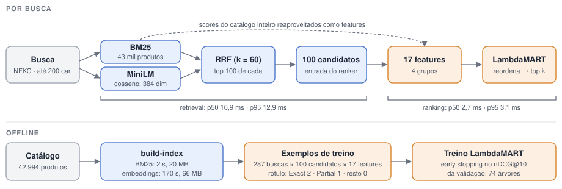

# Busca e ranking de produtos (WANDS)

Busca em duas etapas: **retrieval** (BM25 + embeddings, fundidos por RRF) traz 100 candidatos do catálogo inteiro, e um **LambdaMART** (LightGBM) os reordena com features de texto, atributos e campos numéricos.



| Teste (96 buscas) | nDCG@10 | Recall@100 |
|---|---|---|
| BM25 | 0,694 | 0,609 |
| Híbrido (RRF) | 0,728 | 0,605 |
| **Híbrido + LTR** | **0,764** | 0,605 |

Arquitetura, protocolo, resultados por split, ablações, análise de erros e latência: [`NOTA_TECNICA.md`](NOTA_TECNICA.md) ([PDF](NOTA_TECNICA.pdf)). Tentativas não adotadas: [`EXPERIMENTOS.md`](EXPERIMENTOS.md).

## Como rodar

Requer [uv](https://docs.astral.sh/uv/). Só CPU.

```bash
uv sync                         # Python 3.12 + dependências travadas no uv.lock

uv run pytest                   # testes
uv run split-queries            # split por query (uma vez)
uv run build-index              # BM25 + embeddings (~3 min)
uv run eval-retrieval           # compara retrievers no treino e na validação
uv run train-ranker             # treino, ablação e análise de erros
uv run eval-test                # teste (uma vez; bloqueia reexecução)
uv run benchmark                # latência p50/p95
uv run search "velvet sofa" --k 5
```

Os notebooks ficam em `analysis/`, já executados. Para reexecutar um deles: `uv run jupyter nbconvert --execute --inplace --to notebook analysis/<nome>.ipynb`, ou abra no VS Code/Jupyter com o kernel do `.venv`. Os scripts rodam com `uv run python analysis/<nome>.py`.

### Depois de mudar algo

| Mudou | Rodar de novo |
|---|---|
| texto indexado, BM25 (`k1`, `b`) ou modelo de embeddings | `build-index` → `eval-retrieval` → `train-ranker` |
| RRF ou número de candidatos | `eval-retrieval` → `train-ranker` |
| features ou hiperparâmetros do ranker | `train-ranker` |

O ranker sempre precisa ser retreinado quando o retrieval muda, porque aprende sobre os candidatos e os scores que o retrieval entrega.

## Estrutura

```
dataset/         WANDS original (TSV, sem modificação)
figures/         diagrama da arquitetura (usado na nota)
product_search/
  data/          leitura, limpeza dos rótulos, split
  retrieval/     bm25, dense, fusion (RRF)
  ranking/       features (v1), experimental (features não adotadas), model (LambdaMART)
  evaluation/    métricas, bootstrap, runs e análise de erros
  pipeline/      uma etapa por comando (ver acima)
  engine.py      entrada -> retrieval -> ranking
analysis/        estudos fora do pipeline, em ordem de leitura
  01_eda.ipynb                 dados, rótulos e o que vira feature
  02_judged_only.py            treinar só com candidatos julgados
  03_query_class.ipynb         prever a classe do produto pela busca
  04_v2_features.py            features novas somadas à v1
  05_affected_queries.py       as features de número e atributo nas buscas que pedem isso
  06_v3_features.py            correções das features da v1
  07_ranking_alternatives.py   peso do Exact e outros objetivos
  08_error_analysis.ipynb      onde o sistema final erra, com gráficos
  09_embedding_model.py        bge-small no lugar do MiniLM
tests/           limpeza dos rótulos, split, métricas, retrieval, busca com entradas inválidas, features e ranker
reports/
  data/          splits.csv
  retrieval/     metrics.json (treino e validação), index_cost.json
  ranking/       metrics.json (treino, validação e ablação), errors_val.csv
  analysis/      saídas dos estudos
  test.json      resultado final
  latency.json   p50/p95 por etapa
```

## Uso de IA

O código, os notebooks e a documentação foram escritos com apoio do Claude Code. Revisei o código, rodei os testes e conferi os números contra `reports/`.
